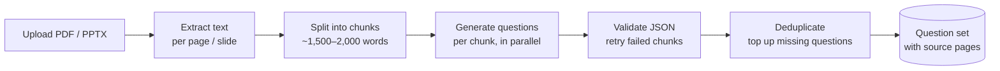

# StudyForge

> Turn lecture slides and PDFs into practice exams with AI, where every question cites the page it came from.


StudyForge is a web application for university students. Upload your course material (PDF or PowerPoint), choose the question type, how many questions you want and the output language, and StudyForge generates a review question set or a mock exam from it.

The main goal is **trustworthy questions**. Each generated question links back to the page or slide it was based on, so students can check the answer against the original material instead of trusting the AI blindly.

> 🚧 **Work in progress.** This project is being built incrementally. Sections marked *(planned)* are not implemented yet. See the [Roadmap](#roadmap).

---

## Table of Contents

- [Features](#features)
- [How It Works](#how-it-works)
- [Tech Stack](#tech-stack)
- [Getting Started](#getting-started)
- [Configuration](#configuration)
- [Project Structure](#project-structure)
- [Roadmap](#roadmap)
- [Design Decisions](#design-decisions)
- [Author](#author)

---

## Features

### v1 scope

| Area | Feature |
|---|---|
| **Upload** | Upload PDF and PPTX files, with file type validated by magic bytes and size/page limits enforced |
| **Generation** | Question types: **Multiple choice**, **Essay**, or **Mixed** |
| | Question count: multiple choice **10 / 30 / 50**, essay **3 / 5 / 7** |
| | Output language: **English** or **Vietnamese** (independent of the document's language) |
| | Short documents (under ~1,500 words) are capped at 10 questions per set, so the AI doesn't pad the set with duplicates or invented content |
| **Questions** | Multiple choice: 4 options, correct answer, explanation, source page |
| | Essay: model answer, grading rubric (key points), source page |
| **Practice** | **Practice mode**: instant feedback after each answer |
| | **Exam mode**: countdown timer, graded on submit, time limit enforced by the server |
| | Questions and answer options are shuffled for every attempt |
| | Results page with explanations and source references, plus attempt history |
| **Account** | Sign in with Google, with a daily generation quota per user |

### Later

- Edit or delete individual questions, and report incorrect questions
- Share a question set via link
- Export to PDF (with and without answer key)
- Image upload (photos of notes or slides)
- AI-assisted grading for essay answers

---

## How It Works



1. **Extraction**: text is extracted page by page (Apache PDFBox for PDF, Apache POI for PPTX) and stored with its page number.
2. **Chunking**: the document is split into chunks. The requested question count is distributed across chunks in proportion to their length.
3. **Parallel generation**: each chunk is sent to the LLM as a separate, size-limited request with bounded concurrency. Generating 50 questions in a single call is slow and unreliable.
4. **Validation and retry**: every response must match a strict JSON schema. Failed chunks are retried individually.
5. **Deduplication**: duplicate questions are removed (normalized text hash plus a database unique constraint). If the set ends up short, extra questions are generated to fill it.
6. **Caching**: results are cached by `sha256(file + settings)`. When two students upload the same slides with the same settings, the LLM is not called again.

Generation runs **asynchronously**. The API returns `202 Accepted` and the client polls the job status. Jobs are queued in PostgreSQL using `SELECT ... FOR UPDATE SKIP LOCKED`, so no separate message broker is needed.

---

## Tech Stack

| Layer | Technology |
|---|---|
| Backend | Java 17, Spring Boot 4, Spring Web MVC, Spring Data JPA, Bean Validation |
| Database | PostgreSQL 17, Flyway migrations |
| Cache | Redis 7 *(planned: rate limiting and caching)* |
| Testing | JUnit 5, Testcontainers (PostgreSQL) |
| Document parsing | Apache PDFBox, Apache POI *(planned)* |
| AI | LLM API with structured JSON output *(planned)* |
| Auth | Google OAuth2 + JWT *(planned)* |
| Frontend | React, Vite, TypeScript *(planned)* |
| DevOps | Docker Compose, GitHub Actions CI |

---

## Getting Started

### Prerequisites

- JDK 17+
- Docker and Docker Compose
- Git

### Run locally

```bash
# 1. Clone
git clone https://github.com/azerc18/study-forge.git
cd study-forge

# 2. Create your environment file and fill in the values
cp .env.example .env

# 3. Start PostgreSQL and Redis
docker compose up -d

# 4. Run the application with the "local" profile
./mvnw spring-boot:run -Dspring-boot.run.profiles=local
```

> **Note:** Spring Boot does not read `.env` files automatically. Export the variables in your shell, or load `.env` in your IDE run configuration (for example, with the IntelliJ EnvFile plugin).

The API runs at `http://localhost:8080`.

### Run tests

```bash
./mvnw verify
```

Integration tests use Testcontainers, so Docker must be running.

---

## Configuration

All settings come from environment variables. See [`.env.example`](.env.example).

| Variable | Description | Example |
|---|---|---|
| `DB_HOST` | PostgreSQL host | `localhost` |
| `DB_PORT` | PostgreSQL port | `5432` |
| `DB_NAME` | Database name | `study_forge` |
| `DB_USERNAME` | Database user | `postgres` |
| `DB_PASSWORD` | Database password | `secret` |
| `REDIS_HOST` | Redis host | `localhost` |
| `REDIS_PORT` | Redis port | `6379` |
| `DEFAULT_PROFILE` | Active Spring profile | `local` |

Spring profiles:

| Profile | Purpose |
|---|---|
| `local` | Development on your machine, with dependencies running in Docker |
| `docker` | Application running inside Docker Compose |
| `prod` | Production deployment |

> Never commit `.env`. It is already listed in `.gitignore`.

---

## Project Structure

```
study-forge/
├── .github/workflows/        # CI pipeline (build + test on push / PR)
├── src/
│   ├── main/
│   │   ├── java/com/az/studyforge/
│   │   └── resources/
│   │       ├── application.yaml          # shared config
│   │       ├── application-{profile}.yaml
│   │       └── db/migration/             # Flyway migrations (V1__, V2__, ...)
│   └── test/
├── docker-compose.yml        # PostgreSQL + Redis for local development
├── .env.example
└── pom.xml
```

The backend is a **modular monolith** with planned modules `auth`, `document`, `generation`, `quiz` and `attempt`. Database migrations are added incrementally, one per feature.

---

## Roadmap

- [x] **M0: Project setup.** Spring Boot, PostgreSQL, Flyway, Docker Compose, CI
- [ ] **M1: Authentication.** Google sign-in, JWT, `GET /me`
- [ ] **M2: Document upload.** PDF/PPTX upload, text extraction per page, length-based limits
- [ ] **M3: Question generation.** Chunking, parallel LLM calls, validation, deduplication, caching, daily quota
- [ ] **First deployment** (VPS + Docker Compose + Nginx + HTTPS)
- [ ] **M4: Practice and exam.** Attempts, shuffling, timer, grading, results
- [ ] **M5: Beta.** Question reports, share links, rate limiting, LLM cost monitoring
- [ ] **M6: Polish.** Integration tests, PDF export, demo screenshots

---

## Design Decisions

- **Source citations on every question.** LLMs can hallucinate. Linking each question to its source page lets users verify it, and the "report question" feature measures the error rate.
- **PostgreSQL as the job queue.** `FOR UPDATE SKIP LOCKED` is enough at this scale and keeps the infrastructure small (no RabbitMQ or Kafka).
- **Chunked, parallel generation.** Many smaller LLM calls are faster and more reliable than one large call, and a single failed chunk can be retried without redoing the whole set.
- **Content-hash caching and daily quotas.** These keep LLM costs predictable for a free project with real users.
- **Server-side exam timing.** The client timer is for display only. The server decides whether a submission is late.

---

## Author

**Le Tran Phuoc Toan**, Software Engineering student at FPT University

- GitHub: [@azerc18](https://github.com/azerc18)
- LinkedIn: [toanle-backend](https://www.linkedin.com/in/toanle-backend)
