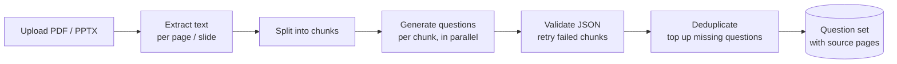
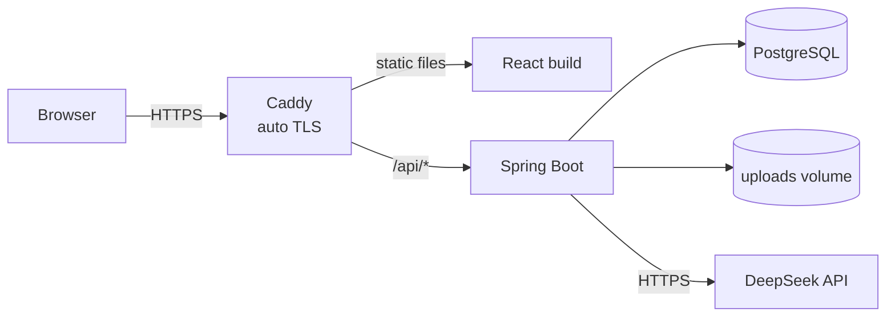

# StudyForge

> Turn lecture slides and PDFs into practice exams with AI, where every question cites the page it came from.


StudyForge is a web application for university students. Upload your course material (PDF or PowerPoint), choose the question type, the number of questions and the output language, and StudyForge generates a review question set from it. You can then practise question by question, get AI feedback on essay answers, or take a timed mock exam.

The main goal is **trustworthy questions**. Each generated question links back to the page or slide it was based on, so students can check the answer against the original material instead of trusting the AI blindly.

🌐 **Live beta:** https://studyforge.duckdns.org (sign in with Google)

---

## Table of Contents

- [Features](#features)
- [How It Works](#how-it-works)
- [Tech Stack](#tech-stack)
- [Getting Started](#getting-started)
- [Configuration](#configuration)
- [Deployment](#deployment)
- [Project Structure](#project-structure)
- [Roadmap](#roadmap)
- [Design Decisions](#design-decisions)
- [Author](#author)

---

## Features

| Area | Feature |
|---|---|
| **Upload** | Upload PDF and PPTX files (max 20 MB, 100 pages), with file type validated by magic bytes. Text is extracted per page / slide in the background |
| **Generation** | Question types: **Multiple choice**, **Essay**, or **Mixed** |
| | Question count: multiple choice **10 / 30 / 50**, essay **3 / 5 / 7** |
| | Output language: **English** or **Vietnamese** (independent of the document's language) |
| | Short documents (under ~1,500 words) are capped at 10 questions per set, so the AI doesn't pad the set with duplicates or invented content |
| | **Generate another set** from the same document without re-uploading. The new set avoids questions from your previous sets |
| | Live progress bar while the set is being generated |
| **Questions** | Multiple choice: 4 options, correct answer, explanation, source page(s), topic |
| | Essay: model answer, key points, source page(s), topic |
| **Practice** | Multiple choice: pick an answer to see right/wrong and the explanation instantly |
| | Essay: write your answer and get **AI feedback**: a score out of 10, what you covered, what you missed, with attempt history |
| **Exam mode** | Timed mock exam on the multiple-choice questions of a set (1–180 minutes), with optional shuffling of questions and options |
| | Time limit enforced by the server, auto-submit at the deadline, answers kept locally if the tab is closed, an unfinished exam can be resumed |
| | Results: score out of 10, **score by topic** with weak topics highlighted, review of all answers or mistakes only, exam history |
| **Account** | Sign in with Google, short-lived access token + rotating refresh token |
| | Daily limits per user: **10 generated sets** and **30 essay gradings** (reset at midnight, Vietnam time) |
| **Admin** | Dashboard with daily activity and AI cost over the last 7–90 days |
| | User management: search, change daily quota, lock / unlock accounts |
| | List of failed generations with the error, and one-click retry |
| **Protection** | Rate limiting per user / IP on sensitive endpoints (`429` + `Retry-After`) |
| | Daily AI spending cap: when the budget is used up, new AI requests are refused until the next day |

---

## How It Works



1. **Extraction**: text is extracted page by page (Apache PDFBox for PDF, Apache POI for PPTX) and stored with its page number.
2. **Chunking**: the document is split into chunks. The requested question count is distributed across chunks in proportion to their length.
3. **Parallel generation**: each chunk is sent to the LLM as a separate, size-limited request with bounded concurrency. Generating 50 questions in a single call is slow and unreliable.
4. **Validation and retry**: every response must match a strict JSON format. Failed chunks are retried individually.
5. **Deduplication**: duplicate questions are removed (normalized text hash plus a database unique constraint). If the set ends up short, extra questions are generated to fill it.
6. **Caching**: results are cached by `sha256(file + settings)`. When two students upload the same slides with the same settings, the LLM is not called again. The cache is skipped when you ask for another set from the same document.

Generation runs **asynchronously**. The API returns `202 Accepted` and the client polls the job status. Jobs are queued in PostgreSQL using `SELECT ... FOR UPDATE SKIP LOCKED`, so no separate message broker is needed.

Every LLM call is logged with its token usage, which is used for the admin cost chart and for the daily budget check.

---

## Tech Stack

| Layer | Technology |
|---|---|
| Backend | Java 25, Spring Boot 4.1, Spring Web MVC, Spring Data JPA, Bean Validation |
| Security | Spring Security (OAuth2 Resource Server, JWT), Google Sign-In |
| Database | PostgreSQL 17, Flyway migrations |
| Document parsing | Apache PDFBox 3, Apache POI 5 |
| AI | DeepSeek API via Spring `RestClient`, structured JSON output, provider fallback list |
| Testing | JUnit 5, Spring MockMvc, Testcontainers (PostgreSQL) |
| Frontend | React 19, TypeScript, Vite, Tailwind CSS 4, TanStack Query, React Router, oxlint |
| DevOps | Docker, Docker Compose, Caddy (reverse proxy + automatic HTTPS), GitHub Actions, Ubuntu VPS |

---

## Getting Started

### Prerequisites

- JDK 25
- Node.js 22
- Docker and Docker Compose
- Git

### Run the backend

```bash
# 1. Clone
git clone https://github.com/azerc18/study-forge.git
cd study-forge

# 2. Create your environment file and fill in the values
cp .env.example .env

# 3. Start PostgreSQL
docker compose up -d

# 4. Run the application (profile "local" by default)
./mvnw spring-boot:run
```

The `.env` file in the project root is loaded automatically (`spring.config.import`).

The API runs at `http://localhost:8080`.

### Run the frontend

```bash
cd frontend
npm ci

# Google OAuth client ID for the sign-in button
echo "VITE_GOOGLE_CLIENT_ID=your-client-id.apps.googleusercontent.com" > .env.local

npm run dev
```

The app runs at `http://localhost:5173`. Requests to `/api` are proxied to the backend on port 8080.

### Run tests

```bash
./mvnw verify                                  # backend: unit + integration tests
cd frontend && npm run lint && npm run build   # frontend: lint + type check + build
```

Integration tests use Testcontainers, so Docker must be running.

---

## Configuration

Backend settings come from environment variables. See [`.env.example`](.env.example).

| Variable | Description | Example |
|---|---|---|
| `DB_HOST` | PostgreSQL host | `localhost` |
| `DB_PORT` | PostgreSQL port | `5432` |
| `DB_NAME` | Database name | `study_forge` |
| `DB_USERNAME` | Database user | `postgres` |
| `DB_PASSWORD` | Database password | `secret` |
| `DEFAULT_PROFILE` | Active Spring profile | `local` |
| `GOOGLE_CLIENT_ID` | Google OAuth client ID (used to verify Google ID tokens) | `xxx.apps.googleusercontent.com` |
| `JWT_SECRET` | Secret used to sign access tokens (at least 32 bytes) | random string |
| `DEEPSEEK_API_KEY` | DeepSeek API key | `sk-...` |
| `STORAGE_DIR` | Folder for uploaded files | `./storage/uploads` |

Frontend (`frontend/.env.local`):

| Variable | Description |
|---|---|
| `VITE_GOOGLE_CLIENT_ID` | Same Google OAuth client ID, used by the sign-in button |

Limits such as the daily AI budget, rate-limit rules, generation concurrency and the essay feedback limit are set in [`application.yaml`](src/main/resources/application.yaml) under `app.*`.

Spring profiles:

| Profile | Purpose |
|---|---|
| `local` | Development on your machine, with PostgreSQL running in Docker |
| `docker` | Application running inside Docker Compose |
| `prod` | Production: secure cookies, forwarded headers from the reverse proxy |

> Never commit `.env`, `frontend/.env.local` or `deploy/.env.prod`. They are listed in `.gitignore`.

---

## Deployment

The beta runs on a single Ubuntu 24.04 VPS (2 vCPU, 4 GB RAM) with Docker Compose.



- [`deploy/docker-compose.prod.yml`](deploy/docker-compose.prod.yml): `postgres`, `backend` (built from the [`Dockerfile`](Dockerfile)) and `caddy`. Data lives in named volumes (`pgdata`, `uploads`, `caddy_data`).
- [`deploy/Caddyfile`](deploy/Caddyfile): serves the frontend, proxies `/api/*` to the backend and gets HTTPS certificates automatically.
- `deploy/.env.prod` exists only on the server and is never committed.
- The database is backed up every night with `pg_dump` (cron), keeping the last 14 days.

### CI/CD

| Workflow | Trigger | What it does |
|---|---|---|
| [`workflow.yml`](.github/workflows/workflow.yml) | Pull request | Backend build + tests |
| [`frontend.yml`](.github/workflows/frontend.yml) | Pull request | Frontend lint + build |
| [`deploy.yml`](.github/workflows/deploy.yml) | Push to `main`, manual | Test and build both apps, copy the jar and the frontend build to the VPS with `rsync`, rebuild the containers, then run a health check |

The deploy workflow uses these repository settings:

- Secrets: `VPS_HOST`, `VPS_PORT`, `VPS_USER`, `VPS_SSH_KEY`, `VPS_KNOWN_HOSTS`
- Variables: `VITE_GOOGLE_CLIENT_ID`, `APP_URL`

---

## Project Structure

```
study-forge/
├── .github/workflows/          # CI (pull requests) and deploy (push to main)
├── deploy/
│   ├── docker-compose.prod.yml # production stack: postgres + backend + caddy
│   └── Caddyfile               # reverse proxy + HTTPS
├── src/
│   ├── main/
│   │   ├── java/com/az/studyforge/
│   │   │   ├── auth/           # Google sign-in, JWT, refresh tokens
│   │   │   ├── user/           # profile, roles, daily quota
│   │   │   ├── document/       # upload, file storage, text extraction
│   │   │   ├── generation/     # chunk planning, LLM client, job worker, quiz sets
│   │   │   ├── feedback/       # AI feedback on essay answers
│   │   │   ├── exam/           # timed exams, scoring, results by topic
│   │   │   ├── admin/          # admin users, stats, failed jobs
│   │   │   └── common/         # config, errors, rate limiting, security helpers
│   │   └── resources/
│   │       ├── application.yaml          # shared config
│   │       ├── application-{profile}.yaml
│   │       └── db/migration/             # Flyway migrations V1__ ... V7__
│   └── test/
├── frontend/
│   └── src/
│       ├── features/           # auth, documents, quizzes, exams, admin
│       ├── pages/              # one component per route
│       ├── layouts/
│       ├── components/
│       └── lib/api.ts          # fetch wrapper with token refresh
├── docker-compose.yml          # PostgreSQL for local development
├── Dockerfile                  # backend image
├── .env.example
└── pom.xml
```

The backend is a **modular monolith**: each feature has its own package with `controller`, `service`, `repository`, `entity` and `dto`. Database migrations are added one per feature.

---

## Roadmap

- [x] Project setup: Spring Boot, PostgreSQL, Flyway, Docker Compose, CI
- [x] Authentication: Google sign-in, JWT, refresh token rotation
- [x] Document upload: PDF/PPTX, text extraction per page, length-based limits
- [x] Question generation: chunking, parallel LLM calls, validation, deduplication, caching, daily quota
- [x] Practice: instant feedback for multiple choice, AI feedback for essays
- [x] Another set from the same document, avoiding repeated questions
- [x] Exam mode: timer, server-side deadline, shuffling, scoring, results by topic, history
- [x] Beta hardening: rate limiting, daily AI budget, admin dashboard
- [x] Deployment: VPS + Docker Compose + Caddy (HTTPS) + GitHub Actions auto-deploy
- [ ] Study streak and a 30-day activity dashboard
- [ ] Badges / rewards
- [ ] Retest on weak topics
- [ ] Report incorrect questions, view the source page next to the question
- [ ] Share a question set via link, PDF export

---

## Design Decisions

- **Source citations on every question.** LLMs can hallucinate. Linking each question to its source page lets users verify it.
- **PostgreSQL as the job queue.** `FOR UPDATE SKIP LOCKED` is enough at this scale and keeps the infrastructure small (no RabbitMQ or Kafka).
- **Chunked, parallel generation.** Many smaller LLM calls are faster and more reliable than one large call, and a single failed chunk can be retried without redoing the whole set.
- **Cost control in layers.** Content-hash caching avoids repeated calls, per-user daily quotas limit each account, rate limiting stops bursts, and a global daily budget (computed from logged token usage and per-provider prices) caps total spending.
- **In-memory rate limiting.** A small token-bucket implementation is enough for a single server. Redis can be added if the backend is ever scaled to several instances.
- **Server-side exam timing.** The client timer is for display only. The server stores the deadline and decides whether a submission is late. A partial unique index guarantees at most one unfinished exam per user and set.
- **Refresh token rotation with reuse detection.** Each refresh issues a new token. If an old token is used again, all sessions of that user are revoked.
- **One small VPS instead of several free tiers.** Frontend, backend and database run together behind Caddy, which keeps latency low for users in Vietnam and keeps the setup easy to reason about.

---

## Author

**Le Tran Phuoc Toan**, Software Engineering student at FPT University

- GitHub: [@azerc18](https://github.com/azerc18)
- LinkedIn: [toanle-backend](https://www.linkedin.com/in/toanle-backend)
